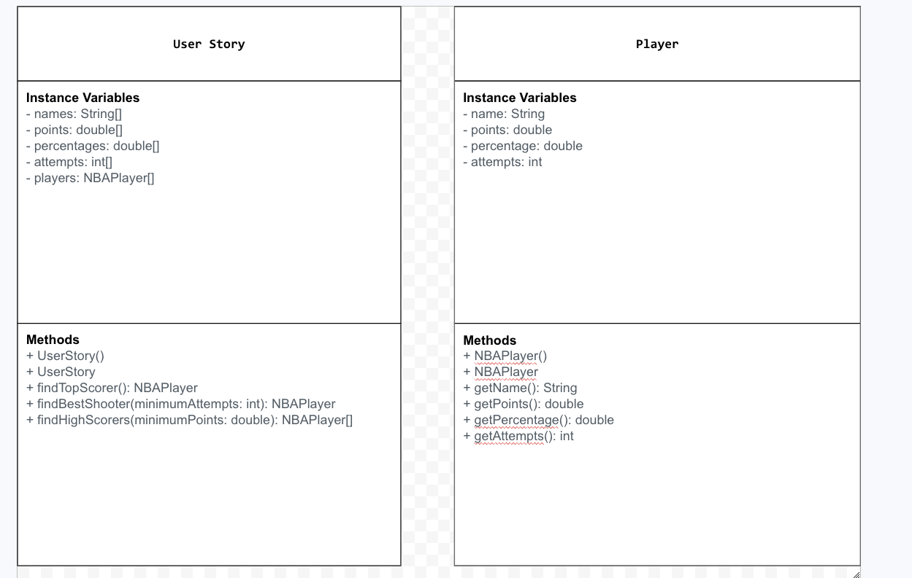

# Unit 3 - Data for Social Good Project

## Introduction

Software engineers develop programs to work with data and provide information to a user. Each user has different needs based on the information they are looking for from data. Your goal is to create a data analysis program for your user that stores and analyzes data to provide the information they need.

## Requirements

Use your knowledge of object-oriented programming, one-dimensional (1D) arrays, and algorithms to create your data analysis program:
- **Write a class** – Write a class to represent your user or business and store and analyze their data with no-argument and parameterized constructors.
- **Create at least two 1D arrays** – Create at least two 1D arrays to store the data that your user needs information about.
- **Write a method** – Write a method that finds or manipulates the elements in a 1D array to provide the information your user needs.
- **Implement a toString() method** – Write a toString() method that returns general information about the data (for example, number of values in the dataset).
- **Document your code** – Use comments to explain the purpose of the methods and code segments and note any preconditions and postconditions.

## User Story 

As an NBA fan, I want to analyze NBA player statistics so that I can identify the best scorers and most efficient shooters.

Question 1
Which NBA player has the highest points per game average?

  Question 2
Which NBA player has the highest field goal percentage?

## Dataset 

Dataset: https://boxscorelab.com/downloads/
- **player_names.txt** (String) - NBA Players names
- **points_pg.txt** (double) - 	Points per game
- **field_goal_pct.txt** (double) - 	Field goal percentage
- **field_goal_attempts.txt** (int) - 	Total field goal attempts

## UML Diagram 

## Description 

Our program has three Java classes: DataRunner runs the program and prints the results, NBAPlayer stores each player's name, points per game, field goal percentage, and shot attempts, and UserStory loads the stats from files into arrays using FileReader. UserStory also builds an array of NBAPlayer objects and uses loops and if statements to find the top scorer, the best shooter (at least 100 attempts), and every player averaging 20 or more points. Its toString() method gives a summary of the dataset. Luka Doncic led in scoring at 39.3 PPG, Walker Kessler had the best shooting percentage at 69.1%, and 43 players averaged at least 20 points. These numbers come from our downloaded data, so they may change.
